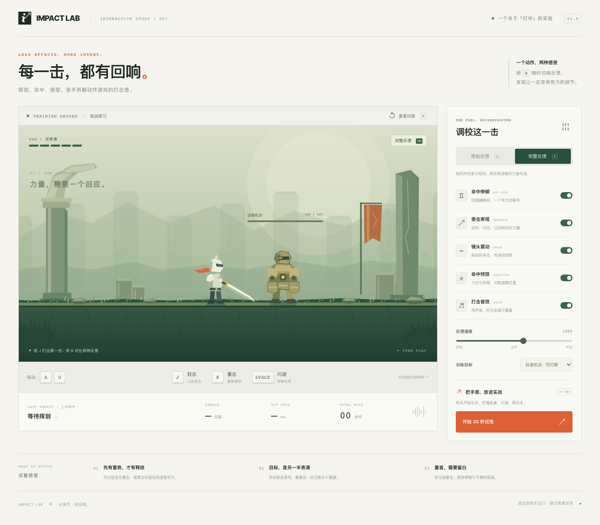

# IMPACT LAB / 打击感实验场

一个可离线运行的 H5 动作小游戏，用来体验「打击感来自清晰的力量传递」这一设计理念。



- [设计方案与实现映射](docs/DESIGN.md)
- [打击感优化调研](docs/RESEARCH.md)
- [验证记录](docs/VALIDATION.md)
- [手机界面预览](docs/images/mobile.png)

## 运行

直接用现代浏览器打开 `index.html`，无需安装依赖。也可以在当前目录运行：

```sh
python3 -m http.server 4173 --bind 127.0.0.1
```

访问 http://127.0.0.1:4173 。在同一局域网的手机上体验时，可改用 `--bind 0.0.0.0` 并访问电脑的局域网 IP。音频由首次操作激活，静音开关位于右侧面板。

## 操作

| 操作 | 按键 |
| --- | --- |
| 左右移动 | A / D 或左右方向键 |
| 轻击，连续输入可衔接三段 | J |
| 蓄势重击 | K |
| 向当前朝向闪避，短暂无敌 | 空格 |
| 切换原始 / 完整反馈 | B |
| 重置当前场景 | R |

屏幕下方提供相同功能的触控按钮；移动按钮支持按住。移动改变朝向，攻击和闪避沿当前朝向发动。闪避有冷却；攻击过程中可缓存下一次操作，不能无限取消攻击。

## 建议的四组实验

1. **同一击，完整 / 原始反馈。**用标准机兵，重置后按 K，记录伤害和命中停顿。切换原始反馈，重置后再按 K。伤害相同，停顿与感官表现不同。
2. **目标是另一半表演。**启用完整反馈，只关闭「受击表现」。比较目标的后仰与闪白消失后，攻击是否仍显得有重量。击退与受击硬直作为战斗规则保留，以免切换时改变压制能力。
3. **轻重攻击的节奏。**连续按 J 接三段轻击，再接 K。默认三段伤害为 12 / 14 / 21，停顿为 45 / 55 / 75 ms；重击伤害 42，停顿 110 ms。重击的准备时间、释放速度和余势更明显。
4. **规则也在表达力量。**切换装甲机兵。装甲仍在时，攻击伤害降为 55%（四舍五入）、击退减弱、无法有效打断；第三次重击破甲，恢复正常伤害与打断。接着参加 30 秒试炼，观察强烈反馈是否帮助你判断下一步行动。

反馈强度只影响命中停顿时长、震屏幅度、粒子数量和音量，不影响伤害、攻击范围、击退或受击硬直。停顿最多为 160 ms，避免极端参数破坏节奏。

## 实验边界

这是用于亲手比较的体验原型，不是证明普适结论的用户研究。命中停顿会占用真实时间，因而可能影响单位时间内的攻击次数；不要直接把不同预设的试炼分数当作打击感优劣。建议先在自由练习中一次只改一个变量，再观察实际战斗体验。

原始反馈仍保留基础挥剑动画、伤害数字、血条、击退和受击硬直。粒子开关同时控制刀光、接触碎屑与闪避残影。受击表现开关控制目标后仰和命中闪白。没有手柄适配，也不请求设备震动权限。

## 实现

- 原生 HTML / CSS / JavaScript；Canvas 2D 绘制所有场景、角色、武器与粒子。
- Web Audio 实时合成挥剑、金属接触、重击、破甲及受伤音效。
- 不依赖外部图片、网络字体、第三方库或构建工具。
- 支持桌面键盘与手机触控，失焦时清除按键状态；尊重系统「减少动态效果」偏好，默认关闭镜头震动。

版本库中的预览图位于 `docs/images/`；本地浏览器验证的临时产物位于 `output/playwright/`，不提交到 Git。
